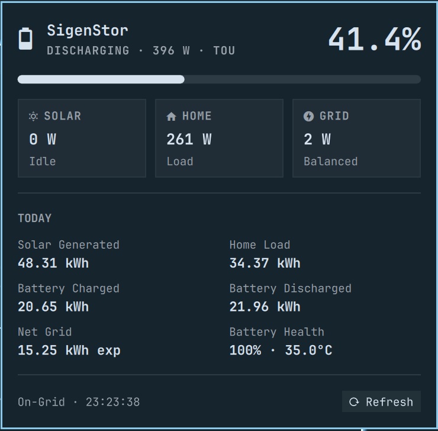

# Omarchy Sigenergy

A native [Omarchy](https://omarchy.org) shell bar widget and popup card for **Sigenergy** (SigenStor / Sigen Hybrid) home solar & battery systems, polled directly over local **Modbus TCP** with zero external dependencies.



## Features

- **Live bar pill:** Shows live **Solar generation** (automatically displayed whenever PV > 0 W), **Home load**, and **Battery State of Charge** with a distinct home-battery icon (`󱤁` / `󱤃` while charging).
- **Theme-native popup card:** Follows your active Omarchy theme colors, fonts, corner radius, and motion settings live.
- **Live power flow tiles:** Solar (PV), Home Load, and Grid (with Importing / Exporting / Balanced state).
- **Today's energy breakdown:** Solar generated, Home load, Battery charged & discharged, Net Grid balance, and Battery health (SoH % + average cell temperature).
- **Zero Python dependencies:** Pure Python 3 standard library (`socket` + `struct`) Modbus TCP client.

## Prerequisites

1. **Enable Modbus TCP** on your Sigenergy inverter/controller via the **mySigen** app (port `502` is disabled by default; some installations require installer permission).
2. Ensure your Omarchy machine and the Sigenergy device are on the **same reachable LAN** (not separated by Guest Wi-Fi client isolation).
3. `python3` (installed by default on Omarchy).

## Installation

```bash
omarchy plugin add https://github.com/mahmudurah/omarchy-sigenergy --enable
```

Then configure your Sigenergy IP address in `~/.config/omarchy/shell.json`:

```json
{
  "id": "io.github.mahmudurah.sigenergy",
  "host": "192.168.1.50",
  "port": 502,
  "refreshSeconds": 15,
  "barMode": "full"
}
```

### Configuration Options

| Key | Type | Default | Description |
| :--- | :--- | :--- | :--- |
| `host` | string | `""` | Local IP address of your Sigenergy Energy Controller / Inverter |
| `port` | number | `502` | Modbus TCP port |
| `refreshSeconds` | number | `15` | Background polling interval in seconds (polls every 5 s while card is open) |
| `barMode` | string | `"full"` | Bar display mode: `full` (Solar + Home + SoC), `soc` (SoC only), or `icon` |

## Controls

- **Left-click:** Toggle the popup card
- **Right-click:** Cycle bar mode (`full` → `soc` → `icon`)
- **Middle-click:** Force an immediate refresh
- **Keyboard (when open):** `R` to refresh, `Esc` to close, `Tab` / `Shift+Tab` to switch panels
- **CLI / IPC:** `omarchy-shell io.github.mahmudurah.sigenergy toggle`

## Removal

```bash
omarchy plugin remove io.github.mahmudurah.sigenergy
```

## License

MIT — see [LICENSE](LICENSE).
